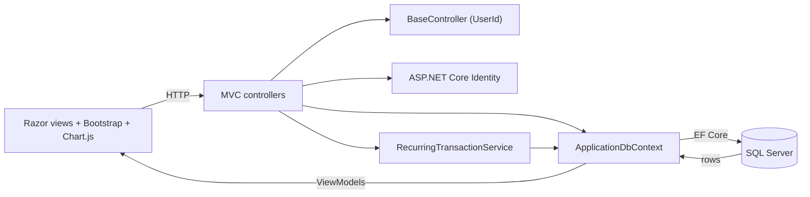
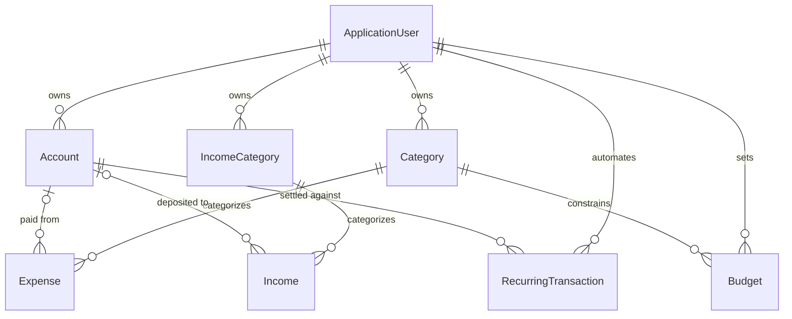

# ExpenseTracker

A personal finance web application built on ASP.NET Core MVC. It tracks income and expenses across multiple wallets, enforces budgets, automates recurring transactions, and turns the result into dashboards, charts, and printable reports. Every record is scoped to the signed-in user, and account balances are kept consistent with the transactions that created them.

[](https://dotnet.microsoft.com/)
[](https://learn.microsoft.com/aspnet/core/mvc/overview)
[](https://learn.microsoft.com/ef/core/)
[](https://www.microsoft.com/sql-server)
[](https://getbootstrap.com/)
[](LICENSE)

---

## Table of contents

- [Overview](#overview)
- [Features](#features)
- [Domain concepts](#domain-concepts)
- [Tech stack](#tech-stack)
- [Architecture](#architecture)
- [Data model](#data-model)
- [Theming system](#theming-system)
- [Project layout](#project-layout)
- [Getting started](#getting-started)
- [Configuration reference](#configuration-reference)
- [Common commands](#common-commands)
- [Conventions and gotchas](#conventions-and-gotchas)
- [Troubleshooting](#troubleshooting)
- [Deployment](#deployment)
- [Known limitations](#known-limitations)
- [License](#license)

---

## Overview

ExpenseTracker is a server-rendered MVC monolith — one ASP.NET Core project, Razor views, EF Core over SQL Server, and no SPA framework or build pipeline on the client. Feature areas map cleanly to controllers: authentication, wallets, expenses, income, categories, budgets, recurring automation, reporting, and profile.

The application is designed so that money never silently goes out of sync: creating, editing, or deleting a transaction adjusts the affected account balances inside a single database transaction, and the recurring engine replays only the periods that have actually come due.

A four-theme, token-driven design system is a first-class part of the app rather than an afterthought — see [Theming system](#theming-system).

---

## Features

| Area                                   | What you get                                                                                                                                                                                                                   |
| :------------------------------------- | :----------------------------------------------------------------------------------------------------------------------------------------------------------------------------------------------------------------------------- |
| **Wallets and accounts**         | Six account types — Cash, Bank, Credit Card, Savings, Investment, Other — each with an opening balance, a live current balance, and an active/inactive flag.                                                                 |
| **Expenses**                     | Create, edit, and delete entries with amount, date, category, optional account, and notes. Balances update on every write. The ledger supports live text search and sorting by category, date, or amount, grouped by category. |
| **Income**                       | The same treatment for money coming in, against its own set of income sources, crediting the selected account.                                                                                                                 |
| **Categories**                   | Independent, user-owned category sets for expenses and for income sources.                                                                                                                                                     |
| **Budgets**                      | A monthly budget per category, with actual spend computed for the same month and a budget-health view on the dashboard showing where the money went.                                                                           |
| **Recurring transactions**       | Daily, weekly, monthly, or yearly automations for either an expense or an income, with start date, optional end date, and an on/off switch. Generated entries are prefixed`[Recurring]`.                                     |
| **Dashboard**                    | Total, this-month, and last-month spending; total and this-month income; category breakdown; budget health; wallet balances.                                                                                                   |
| **Charts**                       | Doughnut chart of spend by category and a bar chart of monthly totals, rendered with Chart.js and re-coloured from the active theme's tokens.                                                                                  |
| **Monthly summary**              | Spend grouped by category for any month and year.                                                                                                                                                                              |
| **Reports**                      | Full date-range report of income and expenses with totals and net position, with dedicated print styles.                                                                                                                       |
| **Authentication and isolation** | Registration and login through ASP.NET Core Identity with cookie authentication; every query is filtered by the current user's id.                                                                                             |
| **Profile**                      | Identity card, activity counters (accounts, categories, expenses, incomes, budgets, automations), edit profile, change password, and theme selection.                                                                          |
| **Interface**                    | Collapsible sidebar (button-driven, remembers its state), sticky topbar, responsive off-canvas navigation and bottom bar on small screens, and a custom toast system for success and error feedback.                           |
| **First-run demo data**          | A ready-to-use demo account is seeded automatically when no users exist.                                                                                                                                                       |

---

## Domain concepts

A few rules are specific to this app's model and are worth understanding before reading the code.

**Per-user scoping.** Every domain entity carries a `UserId` foreign key to the Identity user, all controllers require authorization, and `BaseController` exposes the caller's id so each query filters by it. There is no cross-user visibility and no admin role.

**Balance integrity.** An expense debits its account; income credits it. Edits revert the original account and apply the new one; deletes revert. Each of these runs inside `_context.Database.BeginTransaction()` so a transaction row and its balance change either both persist or neither does.

**The "To Cash" transfer category.** A category named `To Cash` represents moving money into your cash holdings rather than spending it. When an entry uses it, the amount is credited to the user's Cash account (which is created on demand) instead of being treated as consumption. Because it is a transfer and not a spend, it is excluded from every expense aggregate, chart, budget calculation, and summary. The expense form also disables cash accounts as the payment source for such entries, so money cannot be moved from cash to cash.

**Request-driven recurring engine.** There is no background worker or scheduler. When a user opens the dashboard, `RecurringTransactionService.ProcessPendingTransactions` evaluates each active rule and replays every period that has come due since `LastProcessedDate` (or the start date), creating real expense or income rows and updating balances. A rule that was due five times while the user was away produces five entries in one visit.

**Setup guard.** Recording an expense requires at least one active account and one real category (excluding `To Cash`). Until then, the create action redirects to a guided `SetupRequired` page.

---

## Tech stack

| Layer                 | Choice                                                                                                      |
| :-------------------- | :---------------------------------------------------------------------------------------------------------- |
| Runtime and framework | ASP.NET Core MVC on**.NET 10** (`net10.0`)                                                          |
| Language              | C# with`Nullable` and `ImplicitUsings` enabled                                                          |
| Data access           | Entity Framework Core**10.0.8**, code-first migrations (SqlServer provider)                           |
| Database              | Microsoft SQL Server (Express, LocalDB, or full)                                                            |
| Identity              | ASP.NET Core Identity with a custom`ApplicationUser`, cookie authentication, `AddDefaultTokenProviders` |
| Views                 | Razor views with a shared`_Layout`, no areas, view-scoped `<style>` and `@section Scripts`            |
| CSS framework         | Bootstrap**5.3.3** (vendored under `wwwroot/lib`)                                                   |
| Client scripting      | Vanilla JavaScript and jQuery (vendored), plus jQuery Validation                                            |
| Charts                | Chart.js (CDN)                                                                                              |
| Icons                 | Lucide (CDN,`data-lucide`) and Bootstrap Icons (CDN)                                                      |
| Dialogs               | SweetAlert2 (CDN)                                                                                           |
| Notifications         | Custom toast component (`wwwroot/js/site.js`, styled in `site.css`)                                     |
| Currency formatting   | `System.Globalization.CultureInfo("en-IN")` (₹)                                                          |

---

## Architecture



Requests enter a controller, which resolves the current user through `BaseController`, performs a user-scoped EF Core query, and returns a view strongly typed to an entity or a view model. The only service-layer abstraction is `IRecurringTransactionService`, which owns the catch-up calculation; everything else is controller-to-`DbContext`. Writes that move money are wrapped in explicit database transactions.

Configuration is registered in `Program.cs` (top-level statements): MVC with views, `ApplicationDbContext` backed by `DefaultConnection`, Identity with relaxed password rules, cookie paths, the recurring service scoped per request, exception handling and HSTS outside development, HTTPS redirection, static files, and the demo-user seed.

---

## Data model



Entities live in `Models/Entities/`; their presentation shapes in `Models/ViewModels/`.

| Entity                            | Notes                                                                                                                     |
| :-------------------------------- | :------------------------------------------------------------------------------------------------------------------------ |
| `ApplicationUser`               | Extends`IdentityUser` with `FullName` and `CreatedOn`; maps to the `AspNetUsers` table.                           |
| `Account`                       | `Type` enum, `InitialBalance` and `CurrentBalance` as `decimal(18,2)`, `IsActive`.                              |
| `Category` / `IncomeCategory` | User-owned,`IsActive`; expense and income taxonomies are deliberately separate.                                         |
| `Expense`                       | Required`Category` navigation, optional `Account`, `Amount` as `decimal(10,2)`, `ExpenseDate`, `Description`. |
| `Income`                        | Required`IncomeCategory` id, optional `Account`, `Amount` as `decimal(10,2)`, `IncomeDate`.                     |
| `Budget`                        | One row per category per`Month`/`Year`, `Amount` as `decimal(10,2)` with a greater-than-zero range rule.          |
| `RecurringTransaction`          | `Frequency` and `TransactionType` enums, `StartDate`, `LastProcessedDate`, optional `EndDate`, `IsActive`.    |

`RecurringTransaction.CategoryId` is intentionally an untyped integer: it points at an expense category or an income category depending on `Type`, so it carries no navigation property and no enforced foreign key. The same rule applies to budgets, which reference expense categories only.

---

## Theming system

Colour is centralised in a token layer rather than scattered through the views.

| Theme         | Family | Character                                                                     |
| :------------ | :----- | :---------------------------------------------------------------------------- |
| `daylight`  | light  | Default. Cool light surfaces with soft elevation.                             |
| `midnight`  | dark   | Deep navy with gentle glow and glass accents.                                 |
| `parchment` | light  | Warm sepia, flat, tuned for long reading sessions.                            |
| `onyx`      | dark   | True high-contrast (AAA): pure black, hard borders, shadows and blur removed. |

- **`wwwroot/css/themes.css`** is the single palette. `:root` defines the daylight defaults and each other theme is a `[data-theme="…"]` delta block. Derived values such as borders and washes are computed with `color-mix()` from the ink and surface tokens, so a theme only declares what genuinely differs. The brand hue stays constant across themes.
- **Hooks.** Identity is `data-theme="<id>"`; the family is a `.dark` / `.light` class plus `data-bs-theme` so Bootstrap's own colour mode stays aligned. Components consume tokens only — they never branch on a theme name.
- **No flash of wrong theme.** A small inline script in `_Layout` resolves and applies the theme before first paint. It mirrors the registry in `wwwroot/js/themes.js`, which remains the single source of truth for the theme list.
- **Resolution order.** Explicit user choice in `localStorage`, then `prefers-contrast: more` → `onyx`, then `prefers-color-scheme`, then `daylight`. OS changes are followed live while no explicit choice exists, and older two-theme values are migrated transparently.
- **Controls.** A dropdown in **Profile → Appearance** for authenticated pages, and a compact icon that expands into a horizontal row on the standalone auth and marketing pages. Swatches render as miniature app-window previews of each theme.
- **Charts follow the theme** by resolving token values through the computed style at runtime, so doughnut and bar colours update on a theme switch.

---

## Project layout

```text
Expense_Tracker/
├── ExpenseTracker.slnx
├── README.md
└── ExpenseTracker/
    ├── Controllers/        # Account, Base, Budget, Category, Expense, Home,
    │                       # Income, IncomeCategory, Profile,
    │                       # RecurringTransaction, Report, Wallet
    ├── Data/               # ApplicationDbContext (IdentityDbContext)
    ├── Models/
    │   ├── Entities/       # Account, ApplicationUser, Budget, Category,
    │   │                   # Expense, Income, IncomeCategory, RecurringTransaction
    │   ├── ViewModels/     # Dashboard, chart, budget, report, auth, profile
    │   └── ErrorViewModel.cs
    ├── Services/           # IRecurringTransactionService, RecurringTransactionService
    ├── Migrations/         # 7 EF Core migrations
    ├── Properties/         # launchSettings.json
    ├── Views/
    │   ├── Shared/         # _Layout.cshtml, Error, _ValidationScriptsPartial
    │   └── <Area>/         # One folder per controller
    ├── wwwroot/
    │   ├── css/            # themes.css, layout.css, site.css
    │   ├── js/             # themes.js, site.js
    │   └── lib/            # bootstrap, jquery, jquery-validation
    ├── Program.cs          # DI, Identity, pipeline, demo seed
    ├── appsettings.json    # Local only — git-ignored (connection string)
    ├── appsettings.Development.json
    └── dotnet-tools.json   # Local tool manifest (dotnet-ef)
```

---

## Getting started

### Prerequisites

- [.NET 10 SDK](https://dotnet.microsoft.com/download)
- Microsoft SQL Server — Express, LocalDB, or a full instance
- SQL Server Management Studio or Azure Data Studio, if you want to inspect the database

### 1. Clone

```bash
git clone https://github.com/AFROZ81/Expense_Tracker.git
cd Expense_Tracker
```

### 2. Create the local configuration

`ExpenseTracker/appsettings.json` is **git-ignored** because it holds the connection string, so it must be created once by hand:

```json
{
  "Logging": {
    "LogLevel": {
      "Default": "Information",
      "Microsoft.AspNetCore": "Warning"
    }
  },
  "AllowedHosts": "*",
  "ConnectionStrings": {
    "DefaultConnection": "Server=YOUR_SQL_SERVER;Database=YOUR_DATABASE;Integrated Security=True;Encrypt=True;TrustServerCertificate=True;MultipleActiveResultSets=True"
  }
}
```

Replace `YOUR_SQL_SERVER` with your own instance — a named instance such as `MACHINE\SQLEXPRESS` must be written with a doubled backslash in JSON (`MACHINE\\SQLEXPRESS`), and LocalDB is addressed as `(localdb)\\MSSQLLocalDB`. `YOUR_DATABASE` is simply the name EF will create, so pick any unused one — `ExpenseTrackerDb` is a sensible choice.

The sample uses Windows authentication, so no credentials appear in the file. To use SQL Server authentication instead, remove `Integrated Security=True` and supply `User Id` and `Password`. Keep `TrustServerCertificate=True` only for local development against a self-signed certificate — do not ship it in production.

### 3. Apply the migrations

The tool manifest sets `isRoot: true` inside the `ExpenseTracker` folder, so the tool and EF commands must be run **from that directory**:

```bash
cd ExpenseTracker
dotnet tool restore
dotnet ef database update
```

`dotnet tool restore` installs `dotnet-ef` **10.0.8**, pinned to match the EF Core runtime — the tool's major version must match, or design-time loading fails. This step creates the database named in your connection string and applies all seven migrations.

### 4. Run

```bash
dotnet run
```

The application starts at `http://localhost:5015` (or `https://localhost:7139` with the `https` profile). On first run it seeds the demo account.

### 5. Sign in

| Field    | Value                |
| :------- | :------------------- |
| Email    | `demo@example.com` |
| Password | `Demo@123`         |

The demo user starts with no wallets or categories, so the expense form will route you through the setup guard — add a wallet and a category first, or register your own account.

---

## Configuration reference

| Setting             | Location                                                        | Value                                                           |
| :------------------ | :-------------------------------------------------------------- | :-------------------------------------------------------------- |
| Database connection | `appsettings.json` → `ConnectionStrings:DefaultConnection` | Required                                                        |
| Login path          | `Program.cs` cookie options                                   | `/Account/Login`                                              |
| Access-denied path  | `Program.cs` cookie options                                   | `/Account/AccessDenied`                                       |
| Default route       | `Program.cs`                                                  | `{controller=Home}/{action=Index}/{id?}`                      |
| Development URLs    | `Properties/launchSettings.json`                              | `http://localhost:5015`, `https://localhost:7139`           |
| Password policy     | `Program.cs` Identity options                                 | Minimum length 8; digits, upper, lower and symbols not required |
| Currency culture    | Views,`CultureInfo("en-IN")`                                  | ₹                                                              |
| Theme persistence   | Browser`localStorage`, key `theme`                          | Client-side                                                     |
| Sidebar state       | Browser`localStorage`, key `sidebarExpanded`                | Client-side                                                     |

---

## Common commands

Run these from the `ExpenseTracker` project directory.

| Task                  | Command                                          |
| :-------------------- | :----------------------------------------------- |
| Restore libraries     | `dotnet restore`                               |
| Restore local tools   | `dotnet tool restore`                          |
| Build                 | `dotnet build`                                 |
| Run (development)     | `dotnet run`                                   |
| Run with a profile    | `dotnet run --launch-profile https`            |
| Add a migration       | `dotnet ef migrations add <Name>`              |
| List migrations       | `dotnet ef migrations list`                    |
| Revert last migration | `dotnet ef migrations remove`                  |
| Apply migrations      | `dotnet ef database update`                    |
| Generate a SQL script | `dotnet ef migrations script -o migration.sql` |
| Publish               | `dotnet publish -c Release -o publish`         |

---

## Conventions and gotchas

- **Never hard-code a colour outside `themes.css` theme blocks.** Components consume `--t-*` tokens or their aliases. A raw hex value in a view is what makes a theme leak.
- **Razor escapes `@`.** Inside a view's `<style>` or `<script>` block, write `@@media` and `@@keyframes`.
- **Required navigations are non-nullable,** which is why `Program.cs` sets `SuppressImplicitRequiredAttributeForNonNullableReferenceTypes`. Without it, model binding treats a navigation property as an implicitly required form field and every create or edit post fails validation with an error no visible field can display. Keep entity-bound forms carrying a `ValidationSummary` for the same reason.
- **Nullability warnings are fixed by aligning types with the schema,** not by suppressing them: non-nullable foreign keys imply non-nullable navigations, and `[Required]` strings are declared as `string`.
- **The app does not migrate itself at startup.** `Program.cs` only seeds a demo user, so applying migrations is a deliberate deployment step.
- **Git-ignored paths:** `ExpenseTracker/appsettings.json` (secrets), `Essentials/` (local design notes), `.vscode/`. A clone will not contain them.
- **Standalone pages.** `Home/Index`, `Home/Privacy`, `Account/Login`, `Account/Register`, and `Account/AccessDenied` set `Layout = null` and therefore link the stylesheets and theme bootstrap script themselves. If you add a global asset, update those pages too.
- **Tooling version drift breaks design time.** If `dotnet ef` throws a `TypeLoadException` about `Microsoft.EntityFrameworkCore.Design`, the installed tool and the referenced packages no longer match — re-pin and rebuild.

---

## Troubleshooting

| Symptom                                                                  | Cause and fix                                                                                                                                                                                                                  |
| :----------------------------------------------------------------------- | :----------------------------------------------------------------------------------------------------------------------------------------------------------------------------------------------------------------------------- |
| `A network-related or instance-specific error occurred`                | SQL Server is not running, or`Server=` does not match your instance name. A named instance needs an escaped backslash in JSON — `MACHINE\\SQLEXPRESS`.                                                                    |
| `Cannot open database "<your database>" requested by the login`        | Migrations have not been applied yet — run`dotnet ef database update` from the project folder.                                                                                                                              |
| `The certificate chain was issued by an authority that is not trusted` | Add`TrustServerCertificate=True` to the connection string for local development.                                                                                                                                             |
| `dotnet-ef` commands are not found                                     | Run`dotnet tool restore` from inside `ExpenseTracker/`; the manifest is scoped to that directory.                                                                                                                          |
| `TypeLoadException … EntityFrameworkCore.Design, Version=8.0.0.0`     | Tool/runtime version mismatch. Ensure`dotnet-tools.json` and every EF package are on the same version, then `dotnet clean` and rebuild.                                                                                    |
| Build log shows`Failed to add '…\Temp\.dotnet\tools' to the PATH`     | Informational warning from restoring local tools on a build agent. The published app does not need`dotnet-ef`; it is a design-time tool.                                                                                     |
| Build log shows`An issue was encountered verifying workloads`          | Harmless first-run SDK workload check in a fresh build environment. Set`DOTNET_SKIP_WORKLOAD_INTEGRITY_CHECK=true` to suppress it.                                                                                           |
| An expense form re-renders with no message and nothing is saved          | A model-level validation error with no`ValidationSummary` to display it, or a swallowed save failure — check that the implicit-required option is still set and that the account and category belong to the signed-in user. |
| Theme appears wrong for one frame on load                                | The pre-paint script is missing or out of sync with the registry in`themes.js`.                                                                                                                                              |

---

## Deployment

1. Publish the app: `dotnet publish -c Release -o publish`.
2. Create the target database and apply the schema — either `dotnet ef database update` against the production connection string, or `dotnet ef migrations script` and run the generated SQL in the host's tooling.
3. Provide `appsettings.json` on the server with a `DefaultConnection` for the production database. It is not in source control, so the deployment will not carry it.
4. Ensure the application pool or process runs in the `Production` environment, which enables the exception handler and HSTS.
5. On IIS, install the ASP.NET Core hosting bundle; the published `web.config` sets up the ANCM handler.
6. On managed hosts whose build step restores local tools, set `DOTNET_SKIP_WORKLOAD_INTEGRITY_CHECK=true` to keep the build log clean — the workload check is unrelated to this project, which uses no SDK workloads.

---

## Known limitations

Deliberate boundaries of the current implementation, so the code is not mistaken for something it is not:

- **Recurring entries need a visit.** Processing is triggered by loading the dashboard; there is no scheduler, so a user who never opens the app will see a backlog replayed on their next visit.
- **Receipt scanning is a front-end mock.** The "AI Scan" control on the expense form simulates an analysis and pre-fills the form with sample values; there is no vision service behind it.
- **No HTTP API.** The application serves only its own Razor views.
- **Single currency.** Amounts are stored without a currency code and displayed in ₹.
- **No roles or shared budgets.** Isolation is strictly one user, one dataset.

---

## License

Distributed under the terms of the [MIT License](LICENSE) — Copyright (c) 2026 Afroz. You may use, copy, modify, merge, publish, distribute, sublicense, and sell copies of this software, provided the copyright and permission notice are retained in all copies or substantial portions. The software is supplied as-is, without warranty of any kind.

The third-party front-end libraries vendored under `wwwroot/lib` (Bootstrap, jQuery, jQuery Validation, and jQuery Validation Unobtrusive) stay under their own licenses, which ship alongside them in that folder.

---

## Author

Built and maintained by **Afroz** — [AFROZ81/Expense_Tracker](https://github.com/AFROZ81/Expense_Tracker).
